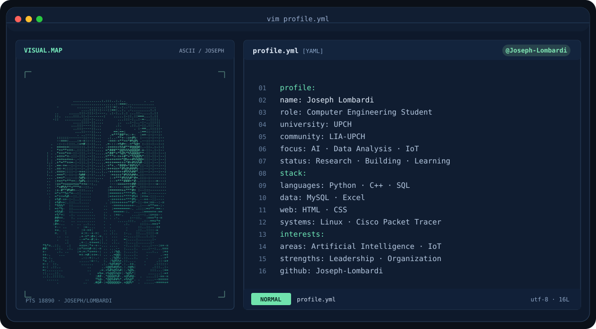

<picture>
  <source media="(prefers-color-scheme: dark)" srcset="assets/banner-dark.svg">
  <source media="(prefers-color-scheme: light)" srcset="assets/banner-light.svg">
  
</picture>

**Ingeniería Informática · UPCH · Sexto ciclo**  
**Computer Engineering · UPCH · Sixth semester**

[Español](#sobre-mí) · [English](#about-me)

## Sobre mí

Soy Joseph Lombardi, estudiante de sexto ciclo de **Ingeniería Informática en la Universidad Peruana Cayetano Heredia**. Me interesan la **inteligencia artificial, el análisis de datos y el Internet de las cosas (IoT)**, y cómo pueden aplicarse a problemas reales.

Actualmente formo parte del **Laboratorio de Inteligencia Artificial de la UPCH**, donde participo en investigación, análisis de datos y apoyo a proyectos de otros laboratorios. Aporto **liderazgo y organización** al trabajo en equipo.

## `$ cat tech-stack.yaml`

<table>
<tr>
<td width="50%" valign="top">

**01 / Programación · Programming**

Python · C++

</td>
<td width="50%" valign="top">

**02 / Datos · Data**

MySQL · SQL · Excel

</td>
</tr>
<tr>
<td valign="top">

**03 / Web**

HTML · CSS

</td>
<td valign="top">

**04 / Sistemas y redes · Systems & networking**

Comandos de Linux / Linux CLI · Cisco Packet Tracer

</td>
</tr>
</table>

## Proyectos destacados · Selected projects

### 01 / LanternGuard

**Visión por computadora · Monitoreo acuícola · Proyecto en desarrollo**

Proyecto de equipo que propone inspeccionar mallas de cultivo de concha de abanico mediante imágenes subacuáticas para evaluar su obstrucción por biofouling. Mi rol es **programador y modelador del sistema**.

*Team project exploring underwater image analysis to assess biofouling on scallop farming nets. My role: **system programmer and modeler**. In development.*

[Explorar proyecto / View project ↗](https://github.com/Joseph-L-Q/PI_Equipo_02)

---

### 02 / Análisis de ciclos de sueño · Sleep cycle analysis

**Machine learning · Regresión lineal · Proyecto académico en desarrollo**

Ejercicio académico orientado a estimar la duración de los ciclos de sueño según la edad del bebé, utilizando regresión lineal y **datos sintéticos**. Su propósito es educativo; no constituye una herramienta clínica.

*Academic project aimed at estimating infant sleep cycle duration from age using linear regression and **synthetic data**. Educational work in progress, with no clinical use.*

[Explorar proyecto / View project ↗](https://github.com/Joseph-L-Q/Analisis-de-los-ciclos-de-sueno-en-recien-nacidos-con-machine-learning)

---

### 03 / AdventureWorks SQL Practice

**SQL Server · AdventureWorks2022 · Consultas SQL**

Repositorio de práctica con ejercicios y consultas SQL sobre la base de datos AdventureWorks2022.

*Practice repository with SQL exercises and queries using the AdventureWorks2022 database.*

[Explorar proyecto / View project ↗](https://github.com/Joseph-Lombardi/adventureworks-sql-practice)

## About me

I'm Joseph Lombardi, a sixth-semester **Computer Engineering student at Universidad Peruana Cayetano Heredia (UPCH)**. My interests span **artificial intelligence, data analysis and the Internet of Things (IoT)**, with a focus on applying them to real-world problems.

I'm currently a member of **UPCH's Artificial Intelligence Laboratory**, contributing to research, data analysis and projects from other university laboratories. I bring **leadership and organizational skills** to collaborative work.

## `$ connect --socials`

¿Conversamos sobre datos, IA o un nuevo proyecto?  
*Let's connect around data, AI or a new project.*

**[LinkedIn](https://www.linkedin.com/in/joseph-lombardi-1b2ba4346)** · **[Email](mailto:josephmlombardiq@gmail.com)** · **[Proyectos académicos / Academic projects](https://github.com/Joseph-L-Q)**

---

Investigar · Analizar · Construir &nbsp; / &nbsp; Research · Analyze · Build

